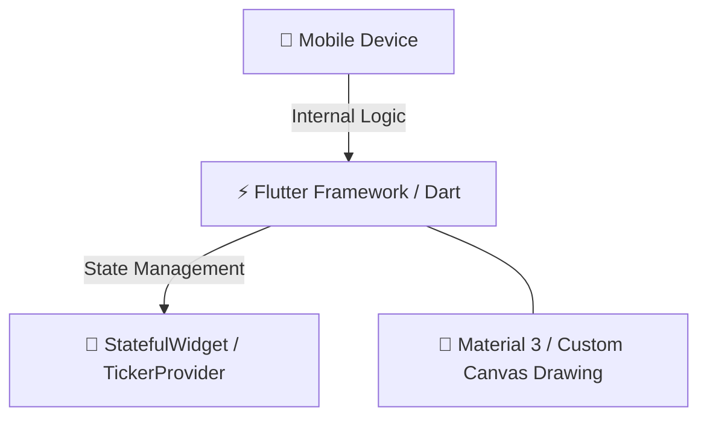

# 🎓 Smart Campus Navigator

A premium, interactive mobile application designed to simplify navigation within a college campus. The system bridges the gap between students, staff, parents, and guests by providing a seamless multi-floor interactive map and tailored role-based access.

---

## 🛠️ Tech Stack & Architecture



### 💻 Frontend Architecture
*   **Flutter (Dart)** – High-performance cross-platform mobile framework.
*   **State Management** – StatefulWidget and TickerProvider used for dynamic UI state and smooth animations.
*   **Material 3 & Canvas** – Modern UI design system with custom drawing to render an interactive map.

---

## 🚀 Key Modules & System Workflow

### ✨ Interactive Splash Screen
*   **Pulsing Logo** – Smooth animations for a modern feel.
*   **Fast Loading** – 0-100% progress tracking in under 2 seconds.

### 🔐 Role-Based Authentication
*   **Tailored Experience** – 4 distinct user roles (Student, Staff, Parent, Guest).
*   **Direct Access** – Parents and Guests can access maps immediately without credentials.
*   **Protected Access** – Robust validation and secure logout redirection for Students and Staff.

### 🗺️ Dynamic Interactive Map
*   **Indoor Navigation** – Navigate specifically within the campus across **3 floors**.
*   **Smart Pathfinding** – High-visibility green paths to indoor locations (e.g., Computer Lab 3 on Floor 3).
*   **Live Guidance** – Simulated user movement along paths with voice and mic integration.
*   **Smart UI** – Auto-hiding navigation bars during active travel for a focused experience.

### 🔎 Smart Search & Discovery
*   **Voice Search** – Integrated mic for hands-free location discovery.
*   **Recent Places** – Quickly return to frequently visited spots.
*   **Quick Categories** – Explore labs, libraries, offices, and more.

### ⚙️ Campus Help & Profile
*   **Feedback Center** – Functional form to submit suggestions and report issues with success alerts.
*   **Profile Management** – Modern edit profile functionality and saved locations.
*   **System Preferences** – Customizable app preferences including font size and style.

---

## 🖥️ System Requirements

*   **Operating System:** Minimum Android SDK version compatible with the latest Flutter engine.
*   **Memory:** 2 GB baseline RAM for smooth map rendering.
*   **Storage Space:** At least 50 MB local storage for the installed app and cached assets.

---

## 📦 Local Installation Guide

1.  **Clone the Repository**
    ```bash
    git clone https://github.com/your-repo/smart-campus-navigator.git
    cd smart-campus-navigator
    ```

2.  **Install Dependencies**
    *   Navigate into the project directory and fetch required packages using Flutter's package manager:
    ```bash
    flutter pub get
    ```

3.  **Run the Live System**
    *   Connect your mobile device or start a local emulator.
    *   Launch the app via your terminal/IDE:
    ```bash
    flutter run
    ```

## Campus Facilities CRUD (Mini-Project / Experiment 13)

The app includes a **Campus Facilities** module linked from the Home screen. It supports creating, viewing, searching/filtering, editing, and deleting classrooms, laboratories, libraries, offices, cafeterias, auditoriums, sports facilities, and other campus locations. The form validates required fields and uses `TextFormField`, `DropdownButtonFormField`, and a responsive list/grid view.

### Browser persistence

Facility records are saved using `shared_preferences`. On Flutter Web, its web implementation persists values in browser `localStorage`, so records remain after refreshing or reopening the same deployed site in the **same browser profile and origin**. Browser privacy settings, private/incognito sessions, clearing site data, or browser storage limits can affect persistence. Local Storage is not a shared database: records do not automatically synchronize between users, browsers, or devices. A backend service/database is needed for shared multi-user records.

### Run locally

Install Flutter (stable) and enable web support, then from this directory run:

```bash
flutter pub get
flutter run -d chrome
```

### Build and deploy

Build the production web bundle:

```bash
flutter pub get
flutter build web --release
```

The deployable static site is in `build/web/`.

**Netlify (manual deploy):** build the app locally with the commands above, then drag the contents of `build/web/` into Netlify's manual deploy page. Use the generated HTTPS URL to test CRUD and refresh persistence.

**GitHub Pages:** push this project to a GitHub repository and enable GitHub Actions and Pages in repository settings. The included `.github/workflows/deploy.yml` builds the Flutter web app and deploys it on pushes to `main`. It uses the repository name as the project-site base path; verify the resulting URL in the workflow's deployment summary.

### Suggested acceptance checks

1. Sign in and open **Facilities** from Home.
2. Add a facility with a name, type, building, and floor; verify it appears in the list.
3. Search by name/building and filter by type.
4. Edit the facility and confirm the new values appear.
5. Remove the facility and confirm it disappears.
6. Add another facility, refresh the deployed HTTPS page, and verify it remains in the same browser.
7. Repeat on a narrow mobile viewport and a wide desktop viewport.

The build/test commands must be run in an environment with Flutter installed; do not treat the checklist as proof that tests have already passed.

## Deploying this Flutter Web app to Vercel

1. Push the project root (the folder containing `pubspec.yaml`, `lib/`, `web/`, and `vercel.json`) to GitHub.
2. In Vercel, import that repository and set **Root Directory** to the repository root (`./`). Do not choose `lib/` or `web/`.
3. Choose **Other** as the framework preset. Let Vercel use the build settings in `vercel.json`; if asked to enter them manually:
   - Install Command: `echo 'Dependencies will be installed by scripts/vercel-build.sh'`
   - Build Command: `bash scripts/vercel-build.sh`
   - Output Directory: `build/web`
4. Deploy. The build script installs Flutter stable, fetches Dart dependencies, and compiles the web app.

If a deployment already exists and shows 404, open **Vercel → Project → Deployments**, redeploy the latest commit after committing `vercel.json` and `scripts/vercel-build.sh`, and check the build log. Ensure the latest GitHub commit contains both files. A successful deploy should publish `build/web/index.html`.
